<p align="center">
  
</p>

<p align="center">
  <a href="https://github.com/Syed-Haseeb97/asset-grabber/blob/main/LICENSE"></a>
  <a href="https://developer.chrome.com/docs/extensions/mv3/"></a>
  <a href="https://github.com/Syed-Haseeb97/asset-grabber"></a>
  <a href="https://github.com/Syed-Haseeb97/asset-grabber"></a>
</p>

---

<p align="center">
  <b><i>"Because your production secrets, `.env` files, and 4K uncompressed marketing hero banners shouldn't be a free public buffet... but here we are."</i></b>
</p>

<p align="center">
  
</p>

## 🧐 What on Earth is This?

Ever visited a website and thought:
- *"I really want every single high-res graphic, video snippet, and PDF on this page without right-clicking 412 times like a medieval peasant."*
- Or worse: *"I wonder if the intern accidentally pushed their `.env` file containing the production Stripe secret key to root?"*

**Asset Grabber 2.0** is the Swiss Army chainsaw Chrome/Edge/Brave extension that turns any web page inside out. Paste a URL (or click on any tab you're logged into), and it will systematically vacuum every image, video, audio file, HLS stream, and document into an instant ZIP archive—while simultaneously running non-destructive forensic security checks to see what confidential goodies your server is handing out to total strangers.

---

<p align="center">
  
</p>

---

## 🚀 The Feature Arsenal

### 1. 🗂️ The Files Vacuum (Bulk Asset Ripper)
*Because right-click 'Save As' is an insult to your CPU.*

- **Fast Scan vs. Deep Scan**:
  - **Fast Scan**: Politely parses raw HTML source in milliseconds.
  - **Deep Scan**: Spawns an offscreen viewport, executes the site's bloated 14MB JavaScript framework, simulates scrolling, triggers lazy-loaders, and wrestles every dynamic asset into view.
- **Whole-Site Spidering**: Follows same-origin links and parses `sitemap.xml` up to 150 pages deep. Perfect for when you need your competitor's entire icon set for "mood board research".
- **Anonymous Access Detective**: Tests every discovered asset logged-out. Instantly know whether that "confidential customer contract PDF" requires authentication or is indexed by Google.
- **HLS Stream Stitcher**: Detects unencrypted `.m3u8` video/audio streams, retrieves the chunks, and stitches them into a pristine `.ts` or `.mp4` container directly in browser memory. (Encrypted DRM streams get rejected politely because we enjoy staying out of court).
- **In-Memory ZIP & CSV**: Filter by extension, sort by file size, and download a bundled ZIP or CSV manifest in one click.

---

<p align="center">
  
  <br/>
  <i>Live footage of your backend server after you forgot to block <code>/.git/config</code></i>
</p>

### 2. 🛡️ The Developer Roaster (Non-Destructive Forensic Audit)
*Run this before your CISO finds out and schedules a 4-hour post-mortem meeting.*

Press **"Find all vulnerabilities and secrets"** to run safe, read-only GET probes across the target:

- **Exposed Server Skeleton**:
  - Probes for `/.env`, `/.git/HEAD`, `.DS_Store`, database SQL dumps, Docker configs, dev server endpoints, and unprotected `robots.txt` paths.
  - Includes heuristic SPA catch-all detection so single-page apps returning `200 OK` HTML for nonexistent routes don't spam you with false positives.
- **Secrets & API Token Sniffer**:
  - Scans client-side JavaScript bundles and responses for unmasked AWS credentials, Stripe private keys, OpenAI / Anthropic tokens, GitHub PATs, and Supabase `service_role` secrets.
  - All sensitive tokens are securely masked on-screen by default until you deliberately click "Reveal".
- **Cloud & Database Leaks**:
  - Tests Supabase public anonymous keys against database tables (reads at most 1 row, never logs data).
  - Checks Firebase Realtime Database rules and tests S3 / Google Cloud Storage / Azure bucket directory listings.
- **Metadata & EXIF Forensics**:
  - Extracts GPS coordinates embedded in uploaded JPEG photos (find out where your founders took their headshots).
  - Extracts corporate author names and internal network paths inside public PDFs and Office documents.
  - Detects executable binaries disguised as harmless files and executable script payloads inside SVGs.

---

## 📦 Installation (Takes ~30 Seconds)

No build steps. No `npm install` downloading half the internet. No webpack agony. Just pure, unadulterated vanilla modern JavaScript.

1. **Clone or Download** this repository:
   ```bash
   git clone https://github.com/Syed-Haseeb97/asset-grabber.git
   ```
2. Open your Chromium-based browser (Google Chrome, Brave, Microsoft Edge, Arc, etc.) and navigate to:
   ```text
   chrome://extensions
   ```
3. Toggle the **Developer mode** switch in the top right corner.
4. Click **Load unpacked** in the top left corner.
5. Select the `asset-grabber` directory.
6. Pin **Asset Grabber** to your browser toolbar!

> 💡 **Pro Tip**: When running a 150-page crawl or downloading a 2GB asset bundle, click **"Open in tab"** in the extension popup. Chrome service workers get sleepy; tabs stay awake and energized.

---

<p align="center">
  
</p>

## 🕹️ How to Use It Without Breaking Anything

| Objective | Steps | What Happens |
| :--- | :--- | :--- |
| **Grab all images on a page** | Open popup ➔ Select *Files* tab ➔ Hit **Fast Scan** ➔ Click **Download All as ZIP** | All media is bundled into a neatly organized `.zip` file. |
| **Audit your staging server** | Open popup ➔ Select *Developer* tab ➔ Hit **Find all vulnerabilities** | Scans for leaks, misconfigured CORS, missing CSP, and exposed secrets. |
| **Test authenticated admin views** | Log into your web app ➔ Open popup ➔ Check **"Scan current tab"** | Inspects assets accessible only to authenticated users without needing password sharing. |
| **Export security audit for boss** | Click **Export Report** ➔ Select **Markdown** | Produces a clean, formatted executive security report ready to paste into Jira or Slack. |

---

## ⚖️ Ethics, Law & The "Don't Be Evil" Clause

Asset Grabber sends **only benign, read-only GET requests**. It doesn't write data, doesn't exploit SQL injections, doesn't brute force passwords, and doesn't bypass DRM.

- **Use it on**: Your own websites, your company's staging environments, client projects with permission, and bug bounties within scope.
- **Don't use it to**: Steal copyrighted media, bombard small servers, or act like an antagonist in a 90s cyber-thriller. You are responsible for your own clicks.

---

## 🛠️ Architecture & Under the Hood

```
asset-grabber/
├── manifest.json       # Manifest V3 extension configuration & permission definitions
├── popup.html          # Sleek dual-tab UI (Asset Explorer & Security Audit Console)
├── popup.css           # Clean, responsive styles with dark-mode aesthetic
├── popup.js            # Main extension orchestrator and user interaction handler
├── background.js       # Background service worker managing tab lifecycles & downloads
├── scanner.js          # Fast HTML parser & DOM crawler
├── crawl.js            # Multi-page BFS site crawler & sitemap.xml parser
├── inspect.js          # Deep headless tab renderer & simulated scroll engine
├── audit.js            # Security engine (regex secret scanners, header analyzer, EXIF parser)
├── stream.js           # HLS (.m3u8) playlist parser and chunk stitcher
├── zip.js              # Pure JavaScript zero-dependency in-memory ZIP builder
└── util.js             # Formatting, sanitization, and network utilities
```

---

## 🤝 Contributing

Found a new API key pattern? Want to add another file signature parser? PRs are warmly welcome!

1. Fork the repository.
2. Create your feature branch (`git checkout -b feature/epic-secret-detector`).
3. Commit your changes (`git commit -m 'Add detection for SuperSecretDB keys'`).
4. Push to the branch (`git push origin feature/epic-secret-detector`).
5. Open a Pull Request and tell us a funny story in the description.

---

## 📜 License

Distributed under the **MIT License**. See [`LICENSE`](LICENSE) for more details.

---

<p align="center">
  <sub>Crafted with forensic precision & dark roast coffee by <a href="https://github.com/Syed-Haseeb97">Syed Haseeb</a>.</sub>
</p>
